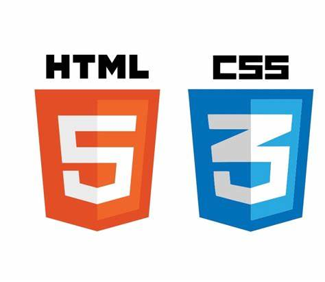

# Geschichte des Internets

## Aufgabe

Lies die Geschichte und frage dich: \
"Welche Erfindungen sind wohl für heutige Websites immer noch wichtig? Welche nicht mehr?"&#x20;

## Internet

Der Vorreiter des Internets entstand in den 50iger Jahren aus der Bedrohungslage während des kalten Krieges in den Vereinigten Staaten. So wollte das US-Militär das Problem lösen, wie US-Regierungsstellen nach einem Atomanschlag sicher und effektiv miteinander kommunizieren können.

Ziel war es ein dezentrales Kommunikationsnetzwerk zu erstellen, wo kein zentraler Server, sondern einzelne Computer als Netzkoten dienen. So sollte das System auch nach einem Teilausfall betrieben werden können, da die einzelnen Netzknoten unabhängig voneinander agieren können.

Um die Bestrebungen zu erreichen, wurde eigens dafür eine Projektgruppe gegründet, die ARPA (Advanced Research Project Agency). Diese nahm 1957 das [ARPAnet](https://de.wikipedia.org/wiki/Arpanet) in Betrieb - das erste dezentrale Computernetzwerk.

1965 wurde dieses Netzwerk auch für nicht militärische Zwecke geöffnet, sodass auch einige Universitäten in den USA mit dem ARPAnet verbunden wurden. Im Jahre 1969 wurde es dann der Öffentlichkeit vor- und freigestellt.

## Das World Wide Web und Webstandards 

Das World Wide Web (WWW) wurde 1989/1990 am [CERN](https://home.cern/science/computing/the-birth-of-the-web/) in Genf erschaffen, um den weltweiten Austausch von Forschungsdokumenten zwischen verschiedenen Universitäten und Instituten zu vereinfachen.&#x20;

Tim Berners-Lee war als Wissenschaftler am CERN beschäftigt und wollte Dokumente über das bereits existierende Internet mithilfe von Hypertext-Verweisen (Links) flexibel miteinander verknüpfen. Die erste Website wurde von TimBerners-Lee am 13. November 1990 von Tim veröffentlicht.

Am 30. April 1993 kündigte das CERN an, dass das World Wide Web für jedermann frei zugänglich sein werde.


Erste Website von Tim Berners-Lee: [The World Wide Web project](http://info.cern.ch/hypertext/WWW/TheProject.html)


### Entwicklung und Standards 

#### 1990 bis 1995: HTML & W3C 

Das **World Wide Web Consortium (W3C)** wurde 1994 mit dem Ziel gegründet, Standards für das Web zu formulieren.

Die ersten HTML-Spezifikationen (HTML 1.0 und 2.0) waren sehr schlicht. Das Einbinden von Bildern und Tabellen war Anfangs noch nicht möglich.&#x20;

#### 1996 bis 1999: Tabellen, IDs, Classes 

HTML 3.2 & HTML 4.01: Tabellen ermöglichten Navigationsleisten und mehrspaltige Layouts. Die Attribute ID und CLASS wurden eingeführt. Bessere Unterstützung von Scripts, Frames, Multimedia und Barrierefreiheit.

CSS1 & CSS 2.0 wurde veröffentlicht. Die Unterstützung der Browser war noch schwach.&#x20;

#### 2000 bis 2006: CSS wird brauchbar 

**CSS** wird endlich von Browsern gut unterstützt und verdrängte die Nutzung von Tabellen zu Layoutzwecken.

#### 2007 bis 2016: Mobile Geräte 

**Die ersten Smartphones** treten auf, Responsive Design und Mobile First etabliert sich.&#x20;

CSS3 bringt wesentliche Neuerungen, z.B.:

* **Responsive Design** (Media Queries)
* **Flexbox und Grid** für komplexere, responsive Layouts
* **Transitions und Animationen** ermöglichen interaktive Interfaces ohne JavaScript
* **Embeded Fonts** für individuelle Schriftarten

#### 2014 bis heute: HTML5 & CSS3 

HTML5 ist da und wird laufend weiter entwickelt. HTML5 bringt wesentliche Neuerungen:

* **Semantische Elemente** wie `<header>`, `<footer>` und `<article>` zur besseren Strukturierung (weniger `
`-Elemente)
* Standardisierte **Multimedia-Elemente** (`<video>`, `<audio>`)
* Verbesserte **Formularfunktionen** mit neuen Eingabetypen wie `email`, `tel`, `range`, `file` und `date`, sowie den Attributen `required` und `placeholder`.
* Einfache Implementierung von Drag-and-Drop
* Unterstützung für Offline-Anwendungen
* Lokale Speicherung und bessere Unterstützung für responsive Designs.

Da CSS3 nun modular aufgebaut ist, gibt es keine kompletten neuen Versionen, sondern es werden laufend einzelne Module weiter entwickelt.

<figure><figcaption></figcaption></figure>
