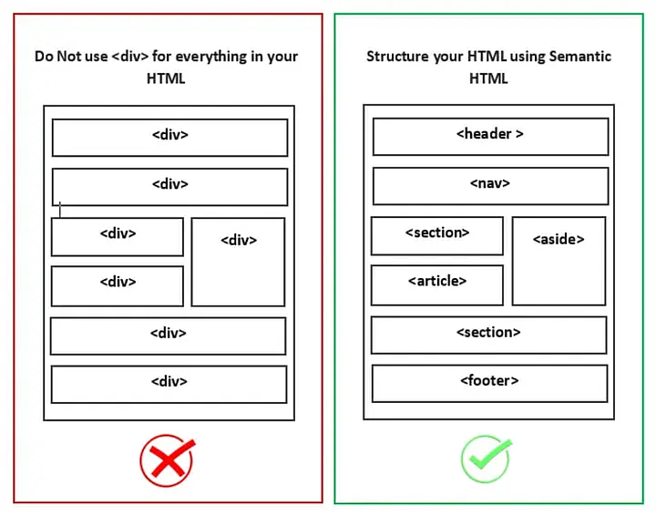

# 📖 Strukturelemente & semantische Tags

Mehrere Tags können zu zusammengehörigen Blöcken zusammengefasst werden. Dazu gibt es sog. Strukturelemente. Es gibt dafür&#x20;

* das **generische Strukturelement** `<div>`, welches nichts über den Inhalt aussagt, und&#x20;
* die **semantischen Strukturelemente** `<header>`, `<footer>`, `<nav>`, `<main>`, `<section>`, `<article>` etc., welche für bestimmte Inhalte vorgesehen sind.

## Strukturelement \<div>

Das Strukturelement `<div>` (Document Division Element) ist ein generischer Container für Inhalte, der keine eigene Bedeutung hat, ausser dass er Elemente zusammenfasst, z.B. um sie im Layout zu positionieren oder zu stylen (mit Hilfe von CSS).

Beispiel: Wir möchten folgende Absätze mit einer Hintergrundfarbe hinterlegen, ohne einen weissen Absand dazwischen zu haben.

```html
<p>Ich bin ein erster Absatz.</p>
<p>Ich bin ein zweiter Absatz.</p>
```

```css
p {
    background-color: indianred;
}
```

Dies entspricht jedoch nicht unserem gewünschten Ergebnis:

<div align="left"></div>

Lösung: Wenn umklammern die beiden Absätze mit einem `<div>`-Strukturelement und stylen das `<div>`-Element:

```html
<div class="red">
    <p>Ich bin ein erster Absatz.</p>
    <p>Ich bin ein zweiter Absatz.</p>
</div>
```

```css
.red {
    background-color: indianred;
}
```

<div align="left"></div>

**Aufgabe:** Teste dieses \<div>-Element mit [Codepen.io](https://codepen.io/sternenvogel/pen/dPMypGe)

## Semantische Strukturelemente

Semtantische Elemente sind gleichbedeutend wie `<div>`-Strukturelemente, definieren aber klar die Bedeutung des Inhalts, welches sie umfassen.&#x20;

**Semantische Elemente haben folgende Vorteile:**&#x20;

* Bessere Lesbarkeit des HTML- und CSS-Codes
* Suchmaschinen können die Struktur der Webseite besser verstehen (SEO)
* Bessere Barrierefreiheit für Menschen unabhängig von Einschränkungen

**Darum gilt:** \
Generische `<div>`-Elemente sollten nur genutzt werden, wenn kein semantisches Element geeignet ist.

<div align="left"><figure><figcaption></figcaption></figure></div>

Folgende Elemente werden häufig genutzt:&#x20;

<table><thead><tr><th width="196.33333333333331">Semantisches Element</th><th width="308">Beschreibung</th><th>Möglicher Inhalt</th></tr></thead><tbody><tr><td><code>&#x3C;header></code></td><td>Das Element beinhaltet Kopfelemente der Website oder einer Sektion.</td><td>Navigation, Logo, Suchfeld</td></tr><tr><td><code>&#x3C;nav></code></td><td>Das Element beinhaltet eine Navigation.</td><td>Navigation</td></tr><tr><td><code>&#x3C;main></code></td><td>Das Element beinhaltet den Hauptinhalt der Website.</td><td>Hauptinhalt</td></tr><tr><td><code>&#x3C;section></code></td><td>Das Element unterteilt ein Dokument in mehrere allgemeine Sektionen.</td><td>Produkte, <br>News</td></tr><tr><td><code>&#x3C;article></code></td><td>Eine Sektion kann mehrere Artikel umfassen.</td><td>Ein Produkt, <br>ein News-Beitrag</td></tr><tr><td><code>&#x3C;aside></code></td><td>Das Element beinhaltet Informationen, welche mit dem Hauptinhalt der Website in Verbindung stehen.</td><td>Sidebar</td></tr><tr><td><code>&#x3C;footer></code></td><td>Das Element beinhaltet Fusselemente der Website oder einer Sektion.</td><td>Copyright, nützliche Links</td></tr></tbody></table>

Weitere Informationen auf [https://www.w3schools.com/html/html5\_semantic\_elements.asp](https://www.w3schools.com/html/html5_semantic_elements.asp)<br>
