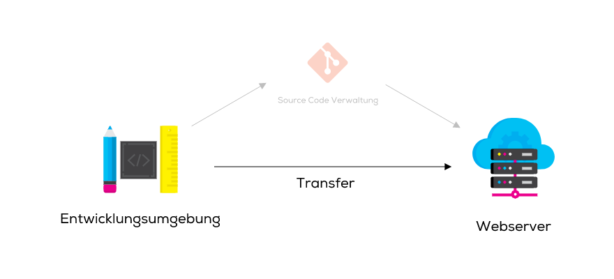

# Veröffentlichen

Als **Go-Live, Veröffentlichung, Launch** oder **Deployment** einer Website bezeichnet man den Vorgang, den neusten Entwicklungsstand einer Website zu veröffentlichen.

Dazu wird ein Webserver genutzt, der über das Internet **24/7** zugänglich ist. Meist nutzt du dafür die Dienstleistungen eines **Webhosting-Anbieters**, der den Webserver für dich betreibt und betreut.

Methoden zur Veröffentlichung von Websites gibt es viele:\
Vom einfachen manuellen Upload per FTP von deinem Rechner auf den Server bis zum vollautomatischen Testing mit anschliessender Veröffentlichung über eine Source Code-Verwaltung (wie z. B. [`git`](https://git-scm.com/)) auf mehrere Server gleichzeitig:

## Transfer

Für den Transfer von Quellcode auf den Server gibt es verschiedenste Methoden. Die am weitesten verbreitete Methode für das manuelle Veröffentlichen ist der Upload via **FTP** oder **SFTP**.

### File Transfer Protocol

Das File Transfer Protocol wurde dafür konzipiert, Dateien in einem Netzwerk von A nach B zu übertragen. Dazu wird ein FTP Server betrieben, zu dem jeder beliebige FTP-Client eine Verbindung aufbauen kann.

Mit einem Benutzernamen und Passwort oder einer Schlüsseldatei kann man sich gegenüber dem Server authentifizieren. Anschliessend können Dateien in beide Richtungen übertragen werden.

### WinSCP

Ein beliebter FTP-Client für Windows ist [**WinSCP**](https://winscp.net/eng/download.php). Die Software ist kostenlos erhältlich.

**Achte darauf, den Download von der offiziellen Projektseite** [**winscp.net**](https://winscp.net/eng/download.php) **zu verwenden. Im Internet sind diverse Installer für WinSCP mit gebundelter Malware zu finden.**

## 🛠️ Aufgabe

Veröffentliche den letzten Stand deiner Arbeit auf den FTP Server der ICT-BZ und rufe sie in deinem Browser und auf deinem Smartphone auf.

**Achtung:** Wir nutzen alle einen gemeinsamen Server, das ist eine gute Gelegenheit, Verantwortung zu üben, sodass alle gut damit arbeiten können.

1. Installiere einen FTP-Client und verbinde dich mit dem Server. Die Zugangsdaten findest du auf deinem [Moodle-Portal](https://moodle.ict-bz.ch/) auf der Kurs-Startseite.
2. Erstelle ein Verzeichnis mit deinem Namen (klein geschrieben, ohne Umlaute und Leerschläge, Minus "-" ist erlaubt). Erstelle darin einen Ordner "tag-1" und lade deine bisherigen Übungen hoch.
3. Rufe deine HTML-Datei(en) im Browser auf.
4. Testen: Werden Bilder und CSS geladen? Sonst finde den Fehler.\
   Tipp: Ev. sind absolute Pfade drin.
5. Schau dir die Seite auch auf dem Handy an.

**Probleme mit absoluten Links:** Falls Links (zu Bildern, CSS etc.) nicht relativ, sondern absolut eingefügt wurden, werden diese nach dem Veröffentlichen nicht mehr funktionieren. Bilder, CSS und ganze Webseiten werden nicht mehr gefunden. => **Nutze möglichst immer relative Links!**
