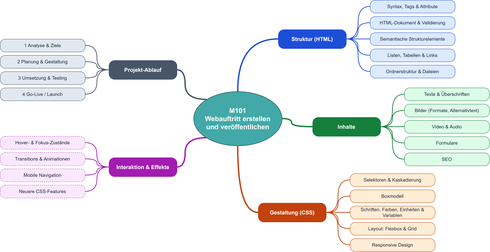

# Überblick

Im Kurs werden wir sowohl die Bestandteile einer Website (Struktur, Inhalt und Gestaltung) als auch den Projektablauf von der Analyse bis zum Go-Live kennen lernen und praktisch umsetzen.

<figure><figcaption></figcaption></figure>
