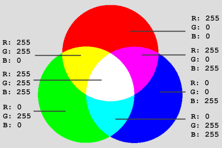
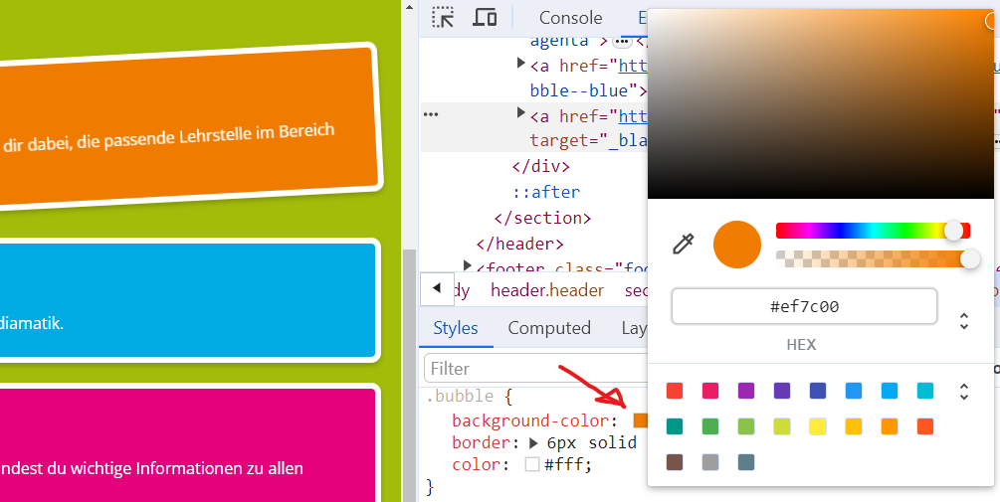
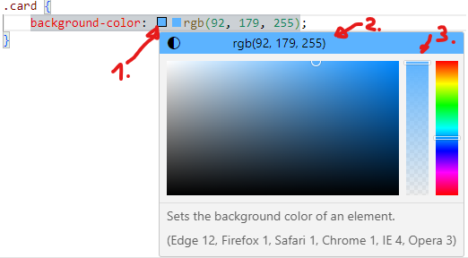

# Farben

## Farbmodelle

Auf Bildschirmen und Beamer werden die Farben _additiv_ aus den drei Grundfarben **R**ot, **G**rün und **B**lau zusammengemischt.&#x20;

In CSS können Farben mit **Farbnamen** oder mit verschiedenen **Farbmodellen** definiert werden.

### Farbnamen

\> [Liste aller unterstützen Farbnamen](https://www.w3schools.com/cssref/css_colors.php)

```css
.navigation {
    color: darkblue;
    background-color: lightgrey;
}
```

### RGB-Farbwerte

Es gibt viele [verschiedene Farbmodelle](https://developer.mozilla.org/en-US/docs/Web/CSS/color_value), die in CSS genutzt werden können. Die häufigsten sind Angaben auf RGB-Basis:&#x20;

<figure><figcaption><p>RGB Farbmodell mit Farbwerten</p></figcaption></figure>

```css
/* RGB (Red, Green, Blue): */
color: rgb(254, 233, 93);

/* RGB Hexadezimal: */
color: #fee95d;
```

Wenn die beiden Hexadezimal-Ziffern je Farbe übereinstimmen, können die abgekürzt werden:&#x20;

```css
color: #fff; /* = #ffffff */
color: #d20; /* = #dd2200 */
color: #000; /* = #000000 */
```

**Transparenz:** Beide können zusätzlich eine 4. Zahl für Transparenz enthalten:&#x20;

```css
/* RGB (Red, Green, Blue) mit 50% Transparenz: */
color: rgba(254, 233, 93, 0.5);

/* RGB Hexadezimal mit 50% Transparenz*/
color: #fee95d88;
```

### Andere Farbmodelle

* [hsl(Farbton, Sättigung, Helligkeit)](https://developer.mozilla.org/de/docs/Web/CSS/Reference/Values/color_value/hsl): Beschreibt Farben auf einer intuitiveren Weise: Farbton (Hue), Sättigung (Saturation) und Helligkeit (Lightness).
* [hwb(Farbton, Weißanteil, Schwarzanteil)](https://developer.mozilla.org/de/docs/Web/CSS/Reference/Values/color_value/hwb): Kombiniert Farbton mit Anteilen von Weiß und Schwarz.
* [lab(Helligkeit, a, b)](https://developer.mozilla.org/de/docs/Web/CSS/Reference/Values/color_value/lab): Ein Farbraum, der die menschliche Farbwahrnehmung nachbildet. Er besteht aus Helligkeit und den Achsen a (Grün-Rot) und b (Blau-Gelb).
* [lch(Helligkeit, Sättigung, Farbton)](https://developer.mozilla.org/de/docs/Web/CSS/Reference/Values/color_value/lch): Auch ein geräteunabhängiger Farbraum, der auf CIELAB basiert, aber Helligkeit, Sättigung (Chroma) und Farbton verwendet.

## Farbwähler im Browser und in Visual Studio Code

Im Browser kannst du über Rechts-Klick > Untersuchen oder mit \[F12] in die DevTools wechseln und dort die Farbe eines Elements in CSS finden und verändern. Auch Transparenz ist möglich. Unterhalb des Farbwertes kann du das Farbmodell wecheln (HEX, RGB, etc.):&#x20;

<figure><figcaption><p>DevTools Farbwähler</p></figcaption></figure>

In Visual Studio Code gibt es beim Bearbeiten von CSS ein ähnliches Tool. Auch hier kannst du das Farbmodell ändern durch Klick auf den Farbwert oben:&#x20;

<div align="left"><figure><figcaption><p>Farbwähler in Visual Studio Code</p></figcaption></figure></div>

1. Farbwähler öffnen
2. Zwischen Farbmodellen umschalten
3. Transparenz setzen

## Links

* [Farbkreis](https://www.figma.com/de-de/farbkreis/) (Figma)
* [Color Wheel](https://www.canva.com/colors/color-wheel/) (Canva)
* [Farbwähler & umwandeln](https://www.mediaevent.de/css/farbrechner.html) (Mediaevent)
