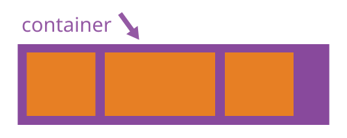
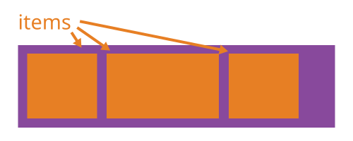

# Konzept der Flexbox

## Wozu braucht man die "CSS Flexbox"?

Wenn eine unbekannte Anzahl von Elementen angeordnet und ausgerichtet werden sollen, kann die Flexbox sehr nützlich sein.&#x20;

**Beispiel: Navigation**

Menü-Optionen werden gleichmässig verteilt:

<figure><figcaption></figcaption></figure>

**Beispiel: Cards mit Newsartikeln**

Mehrere ganze Elemente mit Bild und Text werden angeordnet:

<figure><figcaption></figcaption></figure>

**Beispiel: Bildergalerie**

Elemente werden mehrzeilig oder mehrspaltig dynamisch angeordnet:

<figure><figcaption></figcaption></figure>

\> [Mehr Beispiele](https://www.quackit.com/css/flexbox/examples/flexbox_photo_gallery_examples.cfm)

## Das Konzept

Das Flexbox-Layout-Modul (flexible Boxen) vereinfacht das Layouten, Ausrichten und Ausnutzen des Platzes von Elementen innerhalb eines Containers. Dies vor allem unter der Voraussetzung, dass die Grösse der Elemente unbekannt und/oder dynamisch ist (darum das Wort "flex").

Die Grundidee hinter dem flexiblen Layout ist es, dem Container die Möglichkeit zu geben, seinen Inhalt zu steuern (Höhe, Breite, Reihenfolge), sodass der verfügbare Platz möglichst gut ausgenutzt werden kann (meistens in Anbetracht der verschiedenen Anzeigegeräte und Anzeigegrössen). Der Flex-Container kann somit Elemente vergrössern, verkleinern und umsortieren, um den vorhandenen Platz optimal auszunutzen.


**Achtung:** Flexbox-Layouts wurden nicht dafür konzipiert ganze Layouts zu gestalten, sondern nur für einzelne Komponenten auf einer Website. Für die Seitenlayouts wurde das CSS-Grid-Modul vorgesehen. Dazu später mehr.


***

## Grundlagen und Begriffe

Flexbox ist nicht einfach eine einzelne CSS-Regel, sondern ein ganzes Modul. Das Modul beinhaltet ein ganzes Set aus zusammengehörigen CSS-Regeln. Manche Regeln sind dafür da, den "Flex-Container" zu konfigurieren (das Elternelement), andere wiederum sind für die enthaltenen "Flex-Items" (die Kindelemente).

Während "normale" Layouts auf den Anordnungsrichtungen `display: block` (vertikal) und `display: inline` (horizontal) basieren, basiert das Flex-Layout auf den Flex-Richtungen (`flex-direction`). Die Elemente können sowohl horizontal als auch vertikal angeordnet werden:&#x20;

<figure><figcaption></figcaption></figure>

Das Flexbox-Layout ersetzt oft das ältere System, Elemente mit `display: block` und `display: inline` anzuordnen, weil es viel flexibler und mächtiger ist.&#x20;
