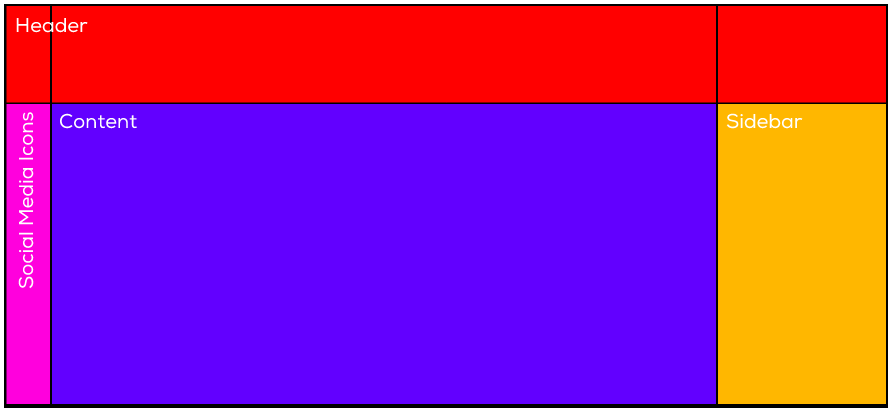
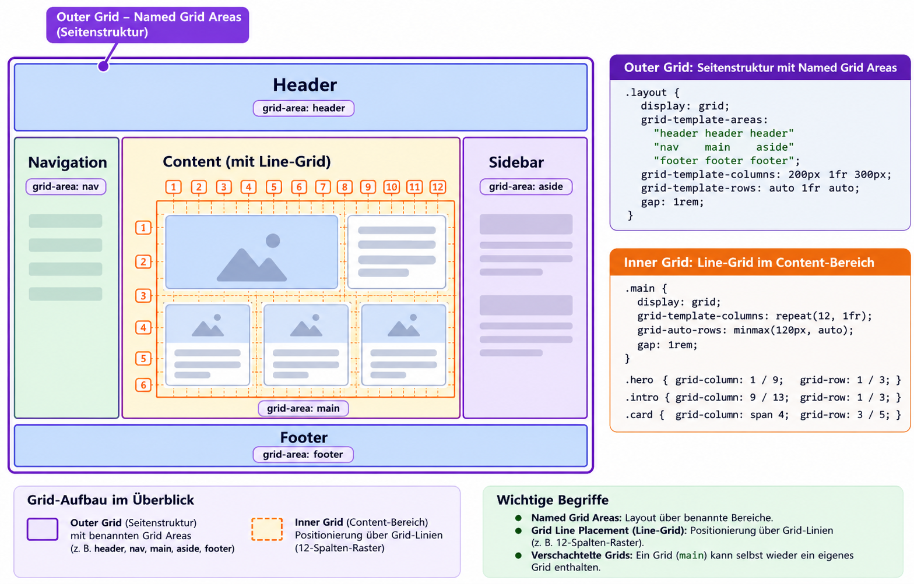
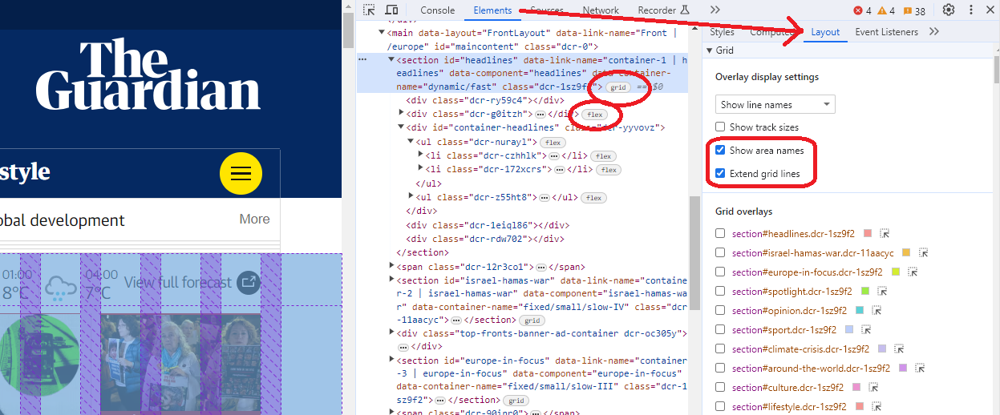

# CSS Grid Layouts & Platzierung

## 🛠️ Aufgabe

Untersuche folgende 3 Websites mit den Browser-Entwicklerwerkzeugen und finde heraus, wo und wie sie Grids nutzen:&#x20;

1. [www.theguardian.com/europe](https://www.theguardian.com/europe)
2. [www.vaude.com](https://www.vaude.com/)
3. [www.berufsberatung.ch/de/berufe/mediamatiker-in-efz](https://www.berufsberatung.ch/de/berufe/mediamatiker-in-efz)

## Arten von Grid-Layouts

Es gibt viele Arten, wie Grids für Layouts genutzt werden können. \
Wir schauen hier zwei verbreitete Varianten an:&#x20;

#### [**Layout mit benannten Grid Areas (Named Grid Areas)**](platzierung.md#layout-mit-benannten-grid-areas-named-grid-areas)



#### [**Layout mit Grid-Linien (Grid Line Placement)**](platzierung.md#layout-mit-grid-linien-grid-line-placement)


## Benannte Grid Areas (Named Grid Areas)

Im Container werden die Areas benannt, in den Items können sie dann zugeteilt werden:&#x20;

### Container: `grid-template-areas`

Mit `grid-template-areas` können bestimmten Bereichen im Grid spezifische Namen vergeben werden.&#x20;

.png>)

In unserem Beispiel gibt es vier Areas: `header`, `social`, `content` und `sidebar`. Die Namen dieser Areas kannst du frei wählen, sie sollten aus Kleinbuchstaben bestehen.

Das Grid wird mit `grid-template-areas` aufgeteilt. Für jede Zeile muss eine Definition erstellt werden. Jede Spalte muss einen Namen erhalten. Spalten und Zeilen mit gleichem Namen gelten als `Area`.

```css
.container {
    display: grid;
    grid-template-columns: 80px auto 260px;
    grid-template-rows:   120px auto;

    /* Die Kommentare sind nur zur besseren Veranschaulichung der Struktur 
     * vorhanden und werden zur eigentlichen Definition nicht benötigt. */
    grid-template-areas: 
         /* S1 */  /* S2 */  /* S3 */
        "header    header    header "   /* Zeile 1 */
        "social    content   sidebar"   /* Zeile 2 */ 
    ;
}
```

### Items: `grid-area`

Elemente im Grid lassen sich jetzt ganz einfach mit `grid-area` platzieren.

```html
<div class="container">
    <header>Header</header>
    <main>Content</main>
    <aside>Sidebar</aside>
    <div class="social">Social Media Icons</div>
</div>
```

```css
header  { grid-area: header;  }
main    { grid-area: content; }
aside   { grid-area: sidebar; }
.social { grid-area: social;  }
```

Siehe [https://codepen.io/anon/pen/ooZVoG](https://codepen.io/anon/pen/ooZVoG).

## Grid-Linien (Grid Line Placement)

Für einheitliche Anordnung von Seiteninhalten wird oft ein Raster hinterlegt, an welchem sich alle Items ausrichten. Häufig wird ein 12er-Raster verwendet, weil dieser leicht durch 2, 3 und 4 teilbar ist (für 2-, 3- und 4-spaltige Layouts).&#x20;

<figure><figcaption></figcaption></figure>

Der Container sieht ähnlich aus. Man kann bequemlichkeitshalber mehrere Spalten auf einmal definieren. Dabei ist die Einheit "fr" = Fraction = Bruchteil geläufig:&#x20;

```css
.container {
    display: grid;
    grid-template-columns: repeat(12, 1fr);
    grid-template-rows: auto 200px; /* optional */
    gap: 20px;
}
```

**Explizite Platzierung über Zeilen und Spalten:**

In den Elementen kann dann die Start- und End-Spalte angegeben werden:&#x20;

```css
.main-article {
    grid-column-start: 3;
    grid-column-end: 9;
    grid-row-start: 1;
    grid-row-end: 2;
    /* oder kurz */
    grid-column: 3 / 9;
    grid-row: 1 / 2;
}
```

**Automatische Platzierung:**

Bei groben Rastern kann das Platzieren der Elemente auch dynamisch passieren, das heisst, die einzelnen Elemente brauchen kein Defintion, sie werden einfach der Reihne nach eingefüllt:&#x20;

```html
<div class="container">
    <article>Produkt 1</article>
    <article>Produkt 2</article>
    <article>Produkt 3</article>
    <article>Produkt 4</article>
    <article>Produkt 5</article>
    <article>Produkt 6</article>
</div>
```

```css
.container {
    display: grid; 
    grid-template-columns: repeat(4, 1fr);
}
```

Fertig. Siehe z.B. [www.vaude.com](https://www.vaude.com/de/de/)&#x20;

## Kombination

Es kann z.B. das Grundlayout mit Named Grid Areas erstellt sein, im Content (`<main>)`  kann ein Linien-Grid eingesetzt werden:&#x20;

<figure><figcaption></figcaption></figure>

## Welche Variante soll ich nutzen? Vor- und Nachteile?

**Feste Layout-Bereiche?** \
**⇒ Benannten Grid Areas (Named Grid Areas)**

Die Zeilennummern von Grid-Linien können sich je nach Bildschirmbreite (Breakpoint) ändern. Dann kann man sich nicht einfach auf die Zeilennummern verlassen oder muss sie im Kopf umrechnen.&#x20;

Der Ansatz der benannten Grid Areas ist da robuster und leichter lesbar. Wir können das Layout für jeden Breakpoint (Bildschirmbreite) mithilfe von `grid-template-areas` innerhalb des Grid-Containers neu definieren und die Zuordnung ist immer noch klar.

**Dynamische Anzahl von Elementen (z.B. Shop-Artikel, News-Beiträge)?** \
**⇒ Layout mit Grid-Linien (Grid Line Placement)**

Ist die Anzahl Items ähnlich wie bei einer Flexbox variabel, können keine festen Namen zugeteilt werden. Da bietet sich das Grid Line Placement an.&#x20;

## Unterstützung in den Browser-DevTools (F12)

In den Entwicklertools findest du unter `Inspect -> Layout` (Firefox) bzw. `Elements -> Layout` (Chrome) den Grid Inspector, der dir beim Arbeiten mit Grids helfen kann:

.png>) .png>)

<figure><figcaption><p>Grids und Flexboxen sind in Chrome leicht zu finden.</p></figcaption></figure>

## Weiterführende Links

* [raidboxes.io/blog/webdesign-development/css-grid-layout/](https://raidboxes.io/blog/webdesign-development/css-grid-layout/)
* [kulturbanause.de/blog/css-grid-layout-module/](https://kulturbanause.de/blog/css-grid-layout-module/)
* [gridbyexample.com/examples/](https://gridbyexample.com/examples/)
