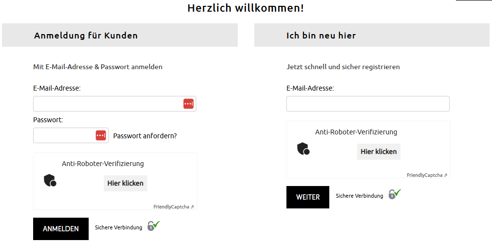
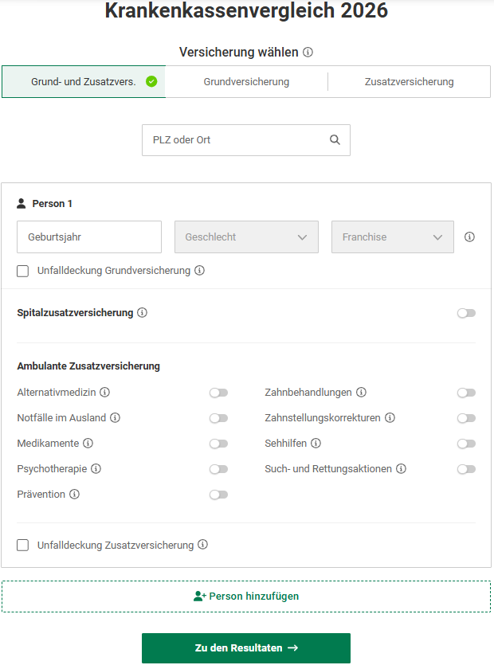
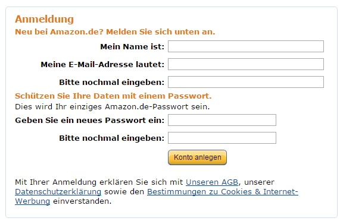
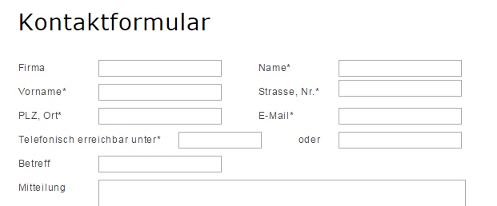
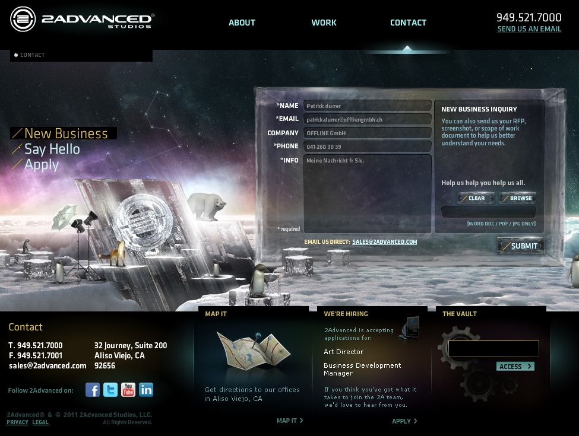
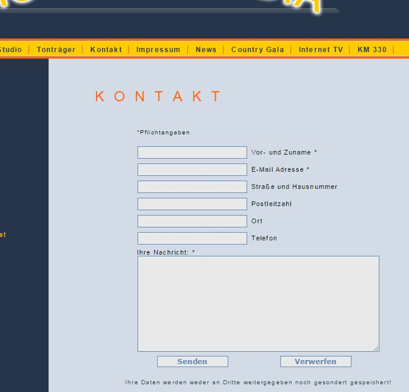

# Formulare: Design-Grundlagen

Zum Einstieg ein kleines Video, wieso User Experience und User Interface Design wichtig sind: [User Experience beim SBB-Automaten](https://www.youtube.com/watch?v=2HdIflrLSLg).

## User Experience (UX)

> «User experience» umfasst alle Erfahrungen, die Menschen bei der Nutzung eines Unternehmens, seiner Dienstleistungen und Produkte machen.

Quelle: [Nielsen Norman Group](https://www.nngroup.com/articles/definition-user-experience/)

## UX bei Formularen

Zwischen dem Ziel eines Benutzers (z. B. kaufen, beitreten, anmelden) und dem Ziel eines Unternehmens (z. B. verkaufen, Mitglieder gewinnen) steht oft ein Formular.

Ein gutes Formular muss deshalb:

* **Nutzbar** sein: Benutzer müssen es problemlos ausfüllen können.
* **Nützlich** sein: Es muss den gewünschten Zweck erfüllen.

## Die drei Komponenten eines Webformulars

Ein gutes Formular verbindet drei Bereiche:

1. [**Beziehung**](formulare-design-grundlagen.md#beziehung) - Vertrauen zwischen Benutzer und Unternehmen schaffen.
2. [**Dialog**](formulare-design-grundlagen.md#dialoge) - Die Kommunikation durch das Formular angenehm gestalten.
3. [**Aussehen**](formulare-design-grundlagen.md#aussehen) - Für eine klare und verständliche Gestaltung sorgen.

### Beziehung

Ein Formular kann Vertrauen schaffen, aber auch zerstören. Beachte deshalb folgende Grundsätze:

* **Vertrauen schaffen:** Logo, Farben, Bilder, Schrift und Sprache sollen einen seriösen Eindruck vermitteln.
* **Ziel festlegen:** Was soll mit dem Formular erreicht werden?
* **Erwartungen erfüllen:** Titel und Inhalt des Formulars müssen zusammenpassen.
*   **Zielgruppe berücksichtigen:** Ein Formular für Privatkunden sieht möglicherweise anders aus als eines für Geschäftskunden oder Mitglieder.

    _Beispiel: Bonprix – unterschiedliche Gestaltung für unterschiedliche Zielgruppen._

<figure><figcaption></figcaption></figure>

*
* **Nur relevante Fragen stellen:** Frage nur Informationen ab, die für den Zweck des Formulars benötigt werden.
* **Konsistent bleiben:** Ändere nicht plötzlich Aufbau oder Gestaltung. Benutzer sollen sich problemlos orientieren können.

### Dialog

Ein Formular ist ein Gespräch zwischen Benutzer und Unternehmen – kein Verhör.

*

    Ein Formular ist ein Gespräch zwischen Benutzer und Unternehmen – kein Verhör.

    * **Freundlich formulieren:** Vermeide aggressive oder unnötig komplizierte Formulierungen.
    * **Logische Reihenfolge:** Beginne mit einfachen, allgemeinen Fragen und gehe erst danach zu persönlichen oder spezifischen Fragen über.
    *   **Themen gruppieren:** Zusammengehörige Fragen sollten auch im Formular zusammenstehen.

        _Beispiel:_ [_Comparis_](https://www.comparis.ch/) _– Informationen sind thematisch und optisch gruppiert:_

<figure><figcaption></figcaption></figure>

* **Pausen einbauen:** Grössere Formulare durch Abstände oder Seitenumbrüche übersichtlicher gestalten.
* **Ablenkungen vermeiden:** Unnötige Elemente entfernen und den Fokus auf das Formular legen.

### Aussehen

Die Gestaltung beeinflusst, wie einfach ein Formular ausgefüllt werden kann.

#### Labels

* **Wörter statt Sätze:** Verwende möglichst kurze Beschriftungen. Ganze Sätze sind nur bei komplexen Fragen sinnvoll. \
  Ein schlechtes Beispiel von Amazon:&#x20;

* **Position der Labels:** Beschriftungen können oberhalb oder neben dem Eingabefeld stehen. Wichtig ist eine einheitliche und gut erkennbare Gestaltung.
*   **Eine Spalte verwenden:** Ordne Felder grundsätzlich untereinander an. Mehrere Spalten erschweren die Orientierung und den Lesefluss.

    _Beispiel: Zweispaltige Formulare sind häufig schwieriger zu erfassen._

#### Formularfelder

* **Passenden Feldtyp wählen:** Überlege, welche Eingabe für die jeweilige Information am sinnvollsten ist (z. B. Textfeld, Auswahlfeld, Checkbox oder Datum).
* **Einfach gestalten:** Verwende eine klare, einheitliche Gestaltung. Aufwendige Designs helfen nicht, wenn die Bedienung dadurch schwieriger wird. &#x20;

#### Aktionen

*   **Aktionen unterscheiden:** Die wichtigste Aktion (z. B. «Absenden») muss optisch hervorgehoben sein. Sekundäre Aktionen (z. B. «Abbrechen») sollten weniger auffällig sein.

    _Schlechtes Beispiel: Absenden und Abbrechen müssen visuell unterscheidbar sein._

*   **Buttons verständlich beschriften:** Verwende konkrete Bezeichnungen statt allgemeiner Begriffe wie «Submit» oder «Reset».

    Beispiele: «Registrieren», «Anfrage senden» oder «Daten speichern».
