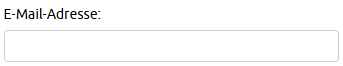
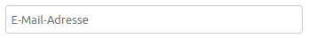
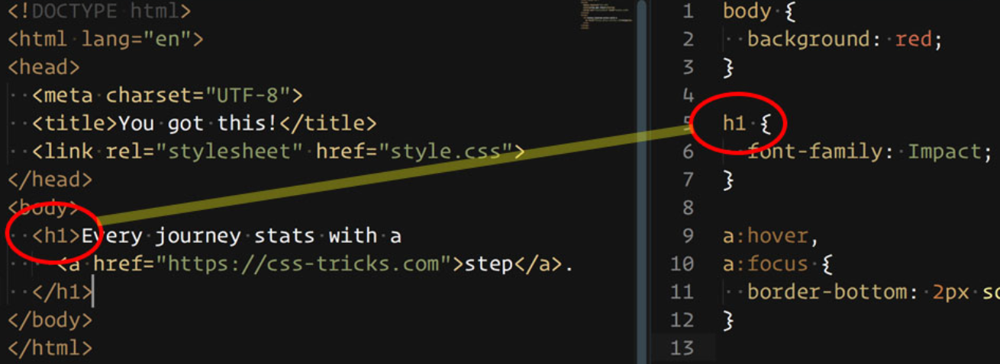
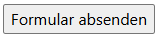

# Formulare & Felder

Unter [w3schools.com/html/html\_forms.asp](https://www.w3schools.com/html/html_forms.asp) findest du eine Übersicht wichtiger Elemente von Formularen und die Möglichkeit, es selber auszuprobieren. Nutze auch `Next >` oben rechts.

## `form`-Tag

Alle Elemente müssen in einem `<form>`-Tag eingefasst sein.

```html
<form action="ziel.php" method="post">
    <label for="feld1">Bezeichnung</label>
    <input type="text" name="feld" id="feld1">
</form>
```

Das `<form>`-Tag braucht mind. 2 Attribute:&#x20;

Das **`action`** -Attribut definiert die URL, wo das Formular hin geschickt werden soll. Meist ein Script auf einem Server, welches die Formulardaten verarbeitet, z.B. in eine Datenbank speichert oder eine E-Mail verschickt.&#x20;

Das **`method`**-Attribut kann die Werte `"get"` oder `"post"` enthalten. \
Meist ist die **Methode `"post"` empfohlen**, weil sie die Daten sicherer an den Server schickt. Mehr auf [www.w3schools.com/tags/att\_form\_method.asp](https://www.w3schools.com/tags/att_form_method.asp)

In diesem Kurs nutzen wir zum Testen das Ziel [https://formlog.ict-bz.ch/](https://formlog.ict-bz.ch/). Deine Daten werden dort 7 Tage gespeichert und danach gelöscht. Die Daten müssen mit der **Methode `"post"`** geschickt werden, `"get"` funktioniert nicht.

## Steuerelemente

### `input`-Typen

In HTML werden die meisten Formularfelder mit dem `input` Tag deklariert. Mit dem `type` Attribut können verschiedene Typen spezifiziert werden. Unter W3Schools.com findest du alle [Input-Typen](https://www.w3schools.com/html/html_form_input_types.asp) mit Beispielen.

**Jedes Feld muss zwingend ein `name` Attribut haben**, sonst wird das Feld beim Versenden nicht mitgeschickt.

```html
<input type="text" name="address">
<input type="email" name="mail">
<input type="checkbox" id="coffee" name="coffee"><label for="coffee">Kaffee</label>
```

### Weitere Form-Elemente

Zudem gibt es mehrzeilige Textfelder (`textarea`), Dropdowns (`select`, `option`) und Schaltflächen (`buttons`). Unter W3Schools.com findest du diese [Form-Elemente](https://www.w3schools.com/html/html_form_elements.asp) mit Beispielen.

```html
<textarea name="remarks" rows="10" cols="4"></textarea>

<select name="anrede">
    <option value="Frau">Frau</option>
    <option value="Herr">Herr</option>
</select>

<button type="submit" name="submit">Formular absenden</button>
```

## Label vs. Placeholder

### Label

Ein alleinstehendes, unbeschriftetes Inputfeld ist für den Besucher nicht brauchbar. Was muss er darin eintragen? Um den Feldern einen Beschreibungstext zu geben, können wir das `label` Tag verwenden.

<div align="left"><figure><figcaption></figcaption></figure></div>

* **Vorteil:** Bei Eingabe ist die Feldbezeichnung weiter sichtbar.
* **Nachteil:** Das Formular braucht etwas mehr Platz.

```html
<label for="email1">E-Mail-Adresse</label><br>
<input type="email" name="mail" id="email1"><br>
```

Das `for` Attribut im Label verweist auf die `id` des Input-Elements.\
Bei einem Klick auf das Label wird der Cursor automatisch ins zugehörige Feld platziert.

Diese Zuordnung ist zudem für Screenreader wichtig, da er nur so weiss, welches Label vorgelesen werden soll, wenn der Cursor ins Feld platziert wird.

### Placeholder

Alternativ kann innerhalb des Feldes ein Placeholder eingefügt werden. Dieser verschwindet, sobald etwas ins Feld geschrieben wird.

<div align="left"><figure><figcaption></figcaption></figure></div>

* **Vorteil:** Das Formular ist kompakter.
* **Nachteil:** Bei Eingabe ist die Feldbezeichnung nicht mehr sichtbar.

```html
<input type="email" name="mail" placeholder="E-Mail-Adresse">
```

## Pflichtfeld: `required`

Das Attribut `required` macht ein Feld zum Pflichtfeld. Es muss ausgefüllt sein, bevor das Formular abgeschickt werden kann. Das Label sollte einen Stern enthalten.

<div align="left"><figure><figcaption></figcaption></figure></div>

```html
<label for="email1">E-Mail *</label><br>
<input type="email" name="mail" id="email1" required>
```

## Feld sperren: `disabled` oder `readonly`

Das Attribut `disabled` bewirkt, dass ein Feld nicht angeklickt und nicht bearbeitet werden kann. Es wird grau dargestellt. **Achtung:** Der Wert eines `disabled`-Feldes wird beim Absenden **nicht** mitgeschickt.

<div align="left"><figure><figcaption></figcaption></figure></div>

```html
<label for="customer-no">Kundennummer:</label><br>
<input type="text" id="customer-no" name="customer-no" value="123456" disabled>
```

Das Attribut `readonly` bewirkt, dass ein Feld zwar anklickbar ist, aber nicht bearbeitet werden kann.

<div align="left"><figure><figcaption></figcaption></figure></div>

```html
<label for="customer-no">Kundennummer:</label><br>
<input type="text" id="customer-no" name="customer-no" value="123456" readonly>
```

## Default-Werte

### Default für `input`-Elemente

Mit dem Attribut `value` kann definiert werden, dass ein Feld beim Laden schon einen Wert enthält und nicht leer ist. Beispiel: Willst du dein Profil auf einer Website bearbeiten, sollen deine bisherigen Daten beim Laden schon drin stehen. Falls vom Besucher nichts geändert wird, wird dieser Wert beim Absenden mitgeschickt (anders als beim Placeholder).

<div align="left"><figure><figcaption></figcaption></figure></div>

<pre class="language-html"><code class="lang-html">&#x3C;label for="customer-no">Kundennummer:&#x3C;/label>&#x3C;br>
&#x3C;input type="text" id="customer-no" name="customer-no" value="123456" readonly>&#x3C;br>

<strong>&#x3C;label for="mail">E-Mail *&#x3C;/label>&#x3C;br>
</strong>&#x3C;input type="email" id="mail" name="mail" value="muster@test.ch">
</code></pre>

### Default für andere Elemente: `textarea`, `select`, `radio`, `checkbox`

```html
<textarea name="comment">Beispieltext</textarea>

<select name="abo">
    <option value="abo-1">Abo 1</option>
    <option value="abo-2" selected>Abo 2</option>
</select>

<input type="radio" name="optionen" value="option-1"> Option 1
<input type="radio" name="optionen" value="option-2" checked> Option 2

<input type="checkbox" name="i-agree" value="i-agree" checked> Ich stimme zu... 
```

## Formular abschicken: Submit-Button

Mit einem `submit`-Button kann das Formular versendet werden. Bei einem Klick darauf wird der Versand der Formulardaten ausgelöst.

<div align="left"><figure><figcaption></figcaption></figure></div>

Es gibt zwei gültige Schreibweisen für einen Submit-Button:

```html
<form action="ziel.php" method="post">

    <label for="feld1">Bezeichnung</label><br>
    <input type="text" name="feld" id="feld1"><br>

    <input type="submit" name="submit" value="Formular absenden">
    <!-- oder -->
    <button type="submit" name="submit">Formular absenden</button>

</form>
```
