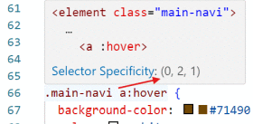

# Kaskadierung - Wer gewinnt?

Es wird in Projekten dazu kommen, dass mehrere CSS-Regeln das gleiche Element ansprechen.

#### index.html

```html
<p class="red">Mein roter Text.</p>
```

#### style.css

```css
p {
    color: black;
}
.red {
    color: red;
}
```

In diesen Fällen stellt sich die Frage: Welche CSS Regel «gewinnt»? Dies wird über einen Mechanismus namens «Cascading» oder Kaskadierung bestimmt.

CSS ist ein Akronym für **\*Cascading** Style Sheets\*. Bei der Kaskadierung geht es darum, dass der Style einmal gestalteter Elemente an anderer Stelle überschrieben werden kann.

Es entscheiden drei Faktoren darüber, welche CSS-Regel «gewinnt»:

1. [Wichtigkeit](07-kaskadierung.md#wichtigkeit)
2. [Spezifizierung](07-kaskadierung.md#spezifizierung)
3. [Platzierung / Reihenfolge](07-kaskadierung.md#platzierung-reihenfolge)

**Beispiel:** Ein Link bekommt generell eine bestimmte Farbe, in der Navigation soll sie aber mit einer anderen Farbe überschrieben werden. Wer gewinnt?

Als kleine Überlegungshilfe gibt es hier das [Punktesystem](https://github.com/johannesE/modul-101/tree/7ef76a9c9f706911092af198dd248f9a2832f329/Tag%201/04%20CSS/05%20Kaskadierung/src/kaskadierung_spezifikation.pdf). Wenn du in Visual Studio Code über einen Selektor fährst, wird das Punktesystem angezeigt:

<div align="left"><figure><figcaption></figcaption></figure></div>

### Spezifizierung

Eine CSS-Regel ist umso stärker, je spezifischer der Selektor definiert wurde.

* Tag-Selektoren (`p`) haben die niedrigste Spezifizierung und sind deshalb am schwächsten.
* `class`-Selektoren (`.red`) haben eine höhere Spezifizierung und sind deshalb stärker als Tag-Selektoren.
* `id`-Selektoren (`#help`) haben die höchste Spezifität und sind deshalb stärker als Tag- und `class`-Selektoren.
*   Verschachtelte Selektoren haben eine höhere Spezifizierung als nicht verschachtelte:

    ```css
    /* Diese Regel überschreibt die Regel für a ganz unten (höhere Spezifität). */
    .navigation a {
      color: red;
    }
    /* a:hover ist genauer spezifiziert als a. Gegenüber .navigation a (gleiche Spezifität) gewinnt a:hover beim Mouse-Over, weil es später steht. */
    a:hover {
      color: green;
    }
    a {
      color: blue;
    }
    ```

### Platzierung / Reihenfolge

Sind sowohl [Spezifizierung](07-kaskadierung.md#spezifizierung) als auch [Wichtigkeit](07-kaskadierung.md#wichtigkeit-important) von zwei Selektoren identisch, entscheidet schlussendlich die Platzierung. Die Regel, die als letztes kommt, überschreibt die vorherigen.

```css
p {
  color: blue;
}
/* Diese Regel überschreibt die oben aufgeführte Regel. */
p {
  color: red;
}
```

### Wichtigkeit (`!important`) - möglichst nicht verwenden!

In CSS kann man mit einem Schlüsselwort sicherstellen, dass Deklarationen _immer_ wichtiger sind als andere, also immer «gewinnen»: `!important`.

index.html:

```html
<p class="red">Mein roter Text.</p>
```

style.css:

```css
p {
    color: black !important;
}
.red {
    color: red;
}
```

Obwohl die Klasse `.red` mehr Gewicht hat als der Tag-Selektor `p` wird schwarz angezeigt, da diese CSS-Regel mit `!important` deklariert wurde.

**WICHTIG:** Nutze diese Syntax möglichst gar nie! Nutze es nur, wenn du absolut keine andere Wahl hast. `!important` schaltet die Logik der Kaskadierung von CSS quasi aus, also eine Grundidee von CSS. Das Element kann danach nicht mehr normal überschrieben werden, nur noch mit erneuter Anwendung von `!important`. Die Notwendigkeit, `!important` zu verwenden, ist meist ein Hinweis auf schlecht strukturierten CSS-Code.

## 🛠️ Aufgaben

**Style deine Website "Über mich" weiter:**

1. Versuche, die Schriftart im Header mit einer anderen Font-Family zu überschreiben.
2. Bilder, welche im Header vorkommen, sollen runde Ecken haben (Radius: 10px).
3. Überschreibe das Styling der Links im Footer (Social-Links):
   * Sie sollen rot sein und nicht unterstrichen.
   * Bei Mouse-Over über die Links im Footer soll die Schrift rot bleiben und der Link-Text unterstrichen werden.

Überprüfe das Resultat im Browser und den Code mit dem [CSS-Validator](https://jigsaw.w3.org/css-validator/#validate_by_input), korrigiere allfällige Fehler.<br>

**Zusatzaufgaben für schnellere Lernende:**

Auf Wunsch der Kundin soll ein alternatives Theme für die Website gewählt werden können.

1. Erstelle eine neue CSS-Datei `color-theme.css` und binde sie in deinem HTML-Dokument NACH `styles.css` ein.
2. Versuche nun in der neuen CSS-Datei einige Hintergrund- und Textfarben des Layouts zu überschreiben.
3. Teste die Webseite mal mit, mal ohne zusätzliches `color-theme.css` und schau dir den Unterschied an.
